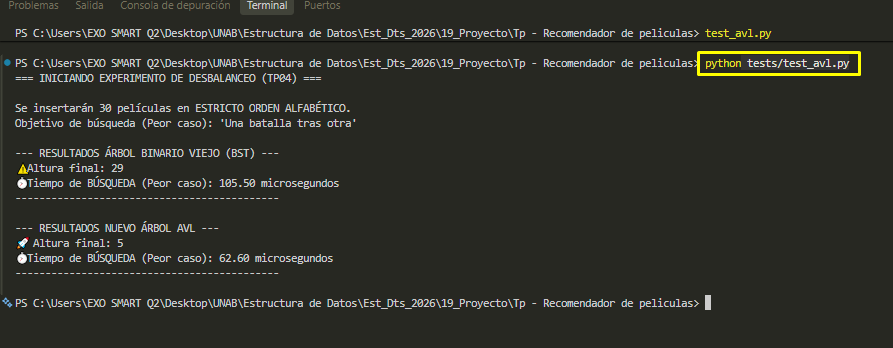

# TP4 — Árbol AVL y desbalanceo

## 1. Objetivo

Mostrar qué le pasa a un árbol binario de búsqueda (TP3) cuando pierde el
equilibrio y cómo lo corrige un AVL.

Código: `services/arbol_catalogo.py` (BST) y `estructuras/arbol_avl.py` (AVL).
Experimento: `tests/test_avl.py`.

## 2. El problema del BST

El BST ordena las películas por título. En cada nodo, los títulos menores van
a la izquierda y los mayores a la derecha. Buscar cuesta tantos pasos como la
**altura** del árbol.

- Con datos mezclados, el árbol queda parejo y la altura es cercana a
  log₂ n: la búsqueda es **O(log n)**.
- Con datos ya ordenados, cada título nuevo es mayor que todos los anteriores
  y va siempre a la derecha. El árbol queda como una lista enlazada, con
  altura n: la búsqueda pasa a **O(n)**.

## 3. La solución: AVL

El AVL es un BST que guarda en cada nodo su altura y controla el **factor de
equilibrio**:

```text
factor = altura(izquierdo) − altura(derecho)
```

Si después de insertar el factor de un nodo sale de [−1, 1], el árbol rota
para volver a equilibrarse.

| Caso | Se detecta cuando | Solución |
| --- | --- | --- |
| Izquierda-izquierda | factor > 1 y el hijo izquierdo pesa a la izquierda | Rotación simple a la derecha |
| Derecha-derecha | factor < −1 y el hijo derecho pesa a la derecha | Rotación simple a la izquierda |
| Izquierda-derecha | factor > 1 y el hijo izquierdo pesa a la derecha | Rotación doble: izquierda sobre el hijo, derecha sobre el nodo |
| Derecha-izquierda | factor < −1 y el hijo derecho pesa a la izquierda | Rotación doble: derecha sobre el hijo, izquierda sobre el nodo |

En el código, `_rotar_simple(raiz, True)` rota a la derecha y `False` a la
izquierda; `_rotar_doble` combina dos rotaciones simples. Las alturas se
actualizan después de cada rotación.

Garantía: la altura de un AVL nunca supera aproximadamente 1,44 · log₂ n, así
que insertar y buscar son **O(log n) siempre**, no solo en promedio.

## 4. Experimento

`tests/test_avl.py` inserta las 30 películas del catálogo **en estricto orden
alfabético** (el peor caso para el BST) y busca la última película, que queda
en el punto más profundo.

```text
python tests/test_avl.py
```



| Estructura | Altura con 30 películas ordenadas | Pasos para llegar a la última |
| --- | --- | --- |
| BST común | **29** | 29 |
| AVL | **5** | 5 |

El BST queda como una lista de 29 niveles. El AVL, con los mismos datos, queda
con 5 niveles, que es lo que se espera de un árbol equilibrado de 30 nodos
(log₂ 30 ≈ 4,9).

Los tiempos en microsegundos también favorecen al AVL, pero varían de una
ejecución a otra (en la captura, 105 µs contra 63 µs). Con solo 30 elementos la
diferencia es chica; **la altura es la medida confiable**, porque no depende de
la máquina. Con miles de películas la diferencia de tiempo crece, porque el BST
degenerado hace n comparaciones y el AVL solo log n.

## 5. Por qué importa el balance

| n películas | Pasos en un BST degenerado (O(n)) | Pasos en un AVL (O(log n)) |
| --- | --- | --- |
| 30 | 30 | 5 |
| 1.000 | 1.000 | 10 |
| 100.000 | 100.000 | 17 |

El BST es más simple, pero su rendimiento depende del orden en que llegan los
datos. El AVL cuesta un poco más al insertar (rotaciones y alturas) y a cambio
garantiza el peor caso.

## 6. Diferencias de implementación

- El AVL ignora títulos duplicados; el BST los acepta a la derecha.
- Ambos normalizan el título (sin tildes ni mayúsculas) antes de comparar.
- Ambos tienen `inorder`, `preorder`, `postorder` y `buscar_exacto`.

## 7. Uso en la aplicación

La opción 1 del menú usa el BST (`ArbolCatalogo`) para la coincidencia exacta
por título. Como el AVL tiene la misma interfaz (`insertar` y `buscar_exacto`),
se puede intercambiar en `Terminal` sin cambiar nada más cuando se quiera la
garantía de O(log n) para cualquier orden de carga.

## 8. Conclusión

Un BST sin control puede degradarse a una lista y perder toda su ventaja. El
AVL lo evita con rotaciones y mantiene la búsqueda en O(log n): en el
experimento redujo la altura de 29 a 5 con los mismos datos.
