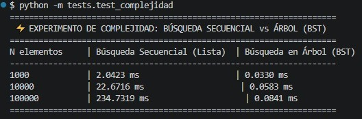

#  TP2: Análisis de Complejidad y Comparación de Estrategias

##  Introducción y Objetivos
El objetivo principal del **TP2** es evaluar y comparar el comportamiento computacional de dos estrategias distintas para resolver una misma operación crítica en el sistema: la **Búsqueda de Película por Título**.

Se evaluó la eficiencia temporal tanto teórica (Notación Big-O) como experimentalmente (medición empírica en milisegundos) al escalar la cantidad de datos de entrada $N$ (1.000, 10.000 y 100.000 elementos).

---

##  Descripción de las Estrategias Implementadas

1. **Estrategia A — Búsqueda Secuencial (Lista):**
   * **Ubicación:** `services/catalogo.py`
   * **Funcionamiento:** Implementación lineal sobre la lista `self._elementos`. Evalúa las películas una a una desde el principio hasta el final hasta hallar la coincidencia.

2. **Estrategia B — Búsqueda en Árbol Binario de Búsqueda (BST):**
   * **Ubicación:** `services/arbol_catalogo.py`
   * **Funcionamiento:** Estructura de Árbol Binario de Búsqueda ordenado alfabéticamente por título. En cada comparación descarta la mitad de los elementos restantes del árbol.

---

##  Resultados Empíricos de Ejecución

Se desarrolló un script de benchmark (`tests/test_complejidad.py`) para medir los tiempos reales mediante `time.perf_counter()`. 

La captura de pantalla con los resultados obtenidos en la consola se encuentra disponible en `docs/capturas/`:

### Tabla Comparativa de Rendimiento

| N Elementos | Búsqueda Secuencial (Lista) | Búsqueda en Árbol (BST) |
| :--- | :--- | :--- |
| **1.000** | $2.0423$ ms | $0.0330$ ms |
| **10.000** | $22.6716$ ms | $0.0583$ ms |
| **100.000** | $234.7319$ ms | $0.0841$ ms |

---

##  Análisis de Complejidad Computacional (Big-O)

### 1. Búsqueda Secuencial (Lista)
* **Peor Caso — $\mathcal{O}(N)$:** Ocurre cuando la película buscada se ubica en la última posición de la lista o no existe en el catálogo. Requiere iterar sobre los $N$ elementos de la lista. En los experimentos reales se observa claramente este comportamiento lineal: al multiplicar el número de elementos por 10 (de 1.000 a 10.000 y de 10.000 a 100.000), el tiempo de ejecución subió proporcionalmente $\approx 10$ veces ($2.04 \text{ ms} \rightarrow 22.67 \text{ ms} \rightarrow 234.73 \text{ ms}$).
* **Mejor Caso — $\Omega(1)$:** Ocurre si la película buscada es la primera de la lista.

### 2. Búsqueda en Árbol Binario de Búsqueda (BST)
* **Peor Caso — $\mathcal{O}(\log N)$:** En un árbol balanceado, cada nivel descartado reduce a la mitad la cantidad de nodos restantes a inspeccionar. Al multiplicar la cantidad de películas por 100 (de 1.000 a 100.000), el tiempo de ejecución apenas aumentó de $0.0330 \text{ ms}$ a $0.0841 \text{ ms}$.
* **Mejor Caso — $\Omega(1)$:** Ocurre si la película buscada se encuentra ubicada en la raíz del árbol.

---

##  Conclusión Técnica

* **Uso de Búsqueda Secuencial (Lista):** Es viable únicamente para **datasets reducidos** ($N < 100$), donde la simplicidad del código prima sobre la eficiencia computacional y la sobrecarga de memoria es nula.
* **Uso de Búsqueda en Árbol (BST):** Es **indiscutiblemente la mejor opción para catálogos de mediano y gran tamaño** ($N \ge 1.000$). En el experimento con $100.000$ elementos, el Árbol logró reducir el tiempo de respuesta de $234.73 \text{ ms}$ a solo $0.08 \text{ ms}$ (una mejora de rendimiento superior al **99.9%**), garantizando que el sistema sea escalable en producción.